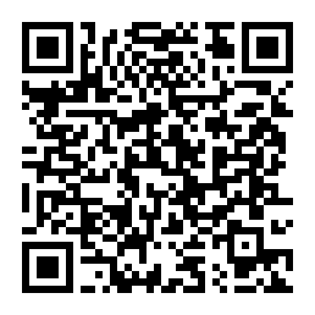

# Iker's Tube

A YouTube client for the Nintendo 3DS / 2DS family (homebrew, needs custom firmware).
Based on [FourthTube](https://github.com/erievs/FourthTube) / ThirdTube, licensed under **GPLv3**.

## Download

<p align="center">
  <a href="https://github.com/IkerPlays/Iker-s-Tube/releases/latest/download/IkersTube.cia">
    
  </a>
</p>

Scan the QR with **FBI** (*Remote Install > Scan QR code*) or click it. It always points to the
`IkersTube.cia` of the **latest stable release**, so it never needs to be updated.
Test builds (pre-releases) are on the [Releases](../../releases) page.

## Install

1. Copy `IkersTube.cia` to your SD card and install it with **FBI** (or use the QR above).
   `IkersTube.3dsx` also works from the Homebrew Launcher.
2. For sound, the DSP firmware dump must exist at `sdmc:/3ds/dspfirm.cdc`.
3. The app checks for updates on start; a red dot appears in the menu when one is available
   (Settings > Update).

Your data lives in `sdmc:/3ds/IkersTube/`.

## Features

- Search with filters, suggestions, Shorts, live streams and chat, subtitles, SponsorBlock.
- Sign in to use your subscriptions, likes, playlists, history and comments.
- Offline: save videos or audio, queue, favorites, watch later.
- Handy extras: sleep timer, data saver, bookmarks, QR codes for links, themes, backups.

Full guide (Spanish): [`Documentation/GUIA_DE_USO.md`](Documentation/GUIA_DE_USO.md).

## Problems

If the app closes at start, it enters **safe mode** on the next launch and resets its settings.
Please open an [issue](../../issues) and attach `crash.txt` / `log.txt` from `sdmc:/3ds/IkersTube/`.

## Building

```
docker run --rm -v $PWD:/src -w /src devkitpro/devkitarm make -j8
```
